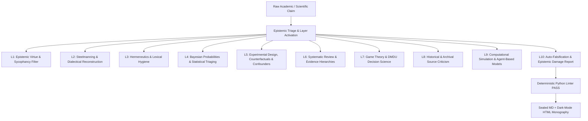

# ⚖️ CRUCIBLE (Mayın Tarlası / Epistemic Minefield Model v6.0)
### An Open-Source Framework for Epistemic Auditing & Dialectical Stress-Testing
*(Global Open-Source Release: **CRUCIBLE** | Canonical Founding Architecture: **Mayın Tarlası [Epistemic Minefield] Model**)*

[](LICENSE)
[](README.md)
[](https://www.python.org/)

> **"A thesis entering this minefield will either see its unexamined premises detonated, retreat under critical wounds for methodological revision, or emerge temporarily reinforced by resisting immediate falsification. The objective is not to declare absolute truth, but to generate uncompromising dialectical friction that reveals the researcher’s own blind spots."**  
> *(The Minefield: The testing ground for unstated axioms and causal fractures; The Crucible: The analytical furnace where rhetorical dross is separated from empirical substance.)*

---

## 🧭 WHAT IS CRUCIBLE IN PLAIN ENGLISH?

> **"From the very first raw data point to the final thesis defense, CRUCIBLE is an open-source framework that forces artificial intelligence into a dispassionate, razor-sharp scientific auditor—specifically engineered to hunt down the hidden flaws, blind spots, and cognitive biases that conceal themselves even from their own author.**  
> 
> **This reviewer will neither flatter your intellect, nor coddle your ego."**

When prompted to analyze complex empirical, clinical, or philosophical monographs, commercial LLMs default to communicative diplomacy: softening analytical contradictions, validating flawed premises to please the user, and producing superficial journalistic summaries.

CRUCIBLE transforms the model into a **forensic prosecutor and senior scientific auditor**:
1. Reconstructing the opponent's thesis in its strongest possible academic formulation (**Steelmanning**).
2. Subjecting the thesis to a 10-layer normative gauntlet to expose hidden confounders, data-theory leaps, proxy errors, and inferential fallacies.
3. Conducting rigorous **Auto-Falsification** (exposing its own blind spots) and verifying the output through a deterministic Python linter before compilation.

---

## ⚡ TWO OPERATING PATHWAYS (QUICKSTART)

Deploy CRUCIBLE immediately based on your technical environment:

### 🌐 Path A: For Web & Cloud Users (Gemini Advanced, Claude.ai, ChatGPT)
*No coding or software installation required. To prevent the model from collapsing into communicative summarization, execution is conducted in **two interactive stages**:*

1. **Stage 1 (Extract the Evidence / Target Dossier):**
   * Open [`templates/CRUCIBLE_EXTRACTION_DIRECTIVE.md`](templates/CRUCIBLE_EXTRACTION_DIRECTIVE.md) and copy the extraction directive.
   * Paste it into your Gemini Advanced, Claude, or ChatGPT session along with your raw PDF or text.
   * The model will extract verbatim assertions, data, and causal claims into a clean, unvarnished **Target Dossier** without editorial commentary.

2. **Stage 2 (Initiate Epistemic Surgery):**
   * Open [`templates/CRUCIBLE_WEB_PROMPT_EN.md`](templates/CRUCIBLE_WEB_PROMPT_EN.md) and copy the single-file system prompt.
   * Instruct the model: *"Now subject the Target Dossier compiled in Stage 1 to the CRUCIBLE 10-layer forensic autopsy."*
   * The model outputs a high-resolution, sycophancy-free monography and an external Surgeon's Audit Card.

*(💡 Pro-Tip: If using Claude.ai Projects or Gemini Gems, upload the markdown files in `docs/` and `templates/` to your project knowledge to create a permanent, dedicated auditing environment.)*

---

### 💻 Path B: For Agentic & IDE Users (Antigravity, Cursor, Claude Code)
*Simply open the repository folder in your IDE. The environment automatically activates the `.cursorrules`, `AGENTS.md`, and `CLAUDE.md` constitutions:*

1. **Open the Project:** Clone or download this repo and open it (`File -> Open Folder -> crucible`).
2. **Issue Single Command:** In your agent's composer or chat window, issue:
   > *"Extract the target dossier from @paper.pdf following @templates/CRUCIBLE_EXTRACTION_DIRECTIVE.md, audit it using CRUCIBLE methodology, and verify output with scripts/crucible_linter.py."*
3. **Receive Sealed Monography:** The agent conducts the audit, executes the deterministic Python linter in the terminal, receives `[PASS]`, and compiles a publication-grade dark-mode `.html` report.

---

## 🚨 CRITICAL OPERATIONAL WARNING: PREVENTING PIPELINE COLLAPSE

> **⚠️ Model Performance Is Not a Physical Constant:**  
> AI providers silently update model weights. A model that flawlessly executes all 11 normative layers today may degrade next week — and vice versa. Always cross-validate critical audits across at least 2 different frontier models.

> **🚨 Mandatory Two-Stage Decoupling:**  
> CRUCIBLE is NOT a one-shot summarizer! Ingesting raw, 400-page manuscripts directly into an LLM with a single prompt triggers immediate *Smoothing Errors*—reducing an audit to an 18 KB journalistic summary. You **MUST** decouple operations into **Stage 1 (Target Extraction)** and **Stage 2 (Crucible Execution)**.

> **🌐 The Law of Substrate Parity (Linguistic Integrity):**  
> For scientific, statistical, and clinical sources constructed in English, forcing the model to generate its analysis in a non-native agglutinative language (such as Turkish) forfeits approximately **50% of the transformer's analytical resolution** due to tokenization bottlenecks. Audits must be executed and sealed natively in English. For local-language dissemination, run an editorial translation pass on the sealed English 4K monography.  
> *(Empirical and hardware proofs codified in `docs/en/03_...`, `docs/en/04_...`, and `docs/en/05_...`)*

---

## 🏛️ METHODOLOGICAL ARCHITECTURE: THE 10 NORMATIVE LAYERS

CRUCIBLE operates on a dynamic **Epistemic Triage Matrix**. Specific epistemic filters are activated based on the primary discipline of the audited claim:



* **Layer 1 (Epistemic Virtue & Demarcation):** Eliminates emotional/moral posturing and enforces intellectual humility.
* **Layer 2 (Steelmanning & Philosophy of Science):** Mandates rebuilding the audited thesis into an academic steelman before any critique is allowed.
* **Layer 3 (Hermeneutics & Meaning):** Strips rhetorical framing, double entendres, and semantic shifts.
* **Layer 4 (Statistics, Probability & Bayes):** Audits effect sizes ($d$), $p$-hacking, prior distributions, and sample sizes ($N$).
* **Layer 5 (Experimental Design & Causality):** Tests counterfactuals, collider bias, and unobserved confounders ($Z$).
* **Layer 6 (Evidence Hierarchies & Systematic Reviews):** Enforces AMSTAR-2, GRADE protocols, and filters out single-case anecdotes.
* **Layer 7 (Decision Science & Risk - DMDU):** Evaluates risk-risk tradeoffs, Fat-Tail exposures, and antifragility under deep uncertainty.
* **Layer 8 (Textual & Historical Criticism):** Enforces primary source triangulation, external/internal criticism, and rejects secondary citations.
* **Layer 9 (Computational Models & AI):** Audits model parameter tuning, overfitting, and validation leakage.
* **Layer 10 (Post-Mortem & Auto-Falsification):** The AI exposes its own analytical blind spots, confessions, and provides a 3-minute **Surgeon Checklist** for external human verification.

---

## 🔬 BENCHMARK SUITE: 9 STRESS-TESTED BATTLEFIELDS

CRUCIBLE v6.0 was validated against 9 contentious academic debates across 5 disparate faculties. Every monography below successfully passed the deterministic linter:

| # | Discipline | Audited Thesis / Author | Key Friction / Vulnerability | Verdict | Monographies |
| :---: | :--- | :--- | :--- | :---: | :--- |
| **01** | **Philosophy & Gender** | **Judith Butler** – *Gender Trouble* (1990) | Linguistic reductionism; denial of biological materiality | Major Revision | [EN Report](showcase/en/01_Judith_Butler_Report.html) \| [TR Report](showcase/tr/01_Judith_Butler_Report.html) |
| **02** | **Psychoanalysis** | **Jacques Lacan** – *Seminaire XX: Encore* (1975) | Pseudoscience of topological formulas (Mathemes) | Major Revision | [EN Report](showcase/en/02_Jacques_Lacan_Report.html) \| [TR Report](showcase/tr/02_Jacques_Lacan_Report.html) |
| **03** | **Clinical Epidemiology** | **Dr. Hilary Cass** – *The Cass Review* (NHS, 2024) | Excessive evidentiary threshold for pediatric cohort data | Minor Revision | [EN Report](showcase/en/03_Cass_Review_Report.html) \| [TR Report](showcase/tr/03_Cass_Review_Report.html) |
| **04** | **Historiography** | **Cheikh Anta Diop** – *The African Origin* (1974) | Anachronistic racial projection; linguistic false cognates | Rejected | [EN Report](showcase/en/04_Cheikh_Anta_Diop_Report.html) \| [TR Report](showcase/tr/04_Cheikh_Anta_Diop_Report.html) |
| **05** | **Classical Philology** | **Frank M. Snowden Jr.** – *Blacks in Antiquity* (1970) | Greco-Roman somatic aesthetics & xenophobia minimized | Minor Revision | [EN Report](showcase/en/05_Frank_Snowden_Report.html) \| [TR Report](showcase/tr/05_Frank_Snowden_Report.html) |
| **06** | **Bibliometrics** | **Cook et al. vs. Tol** – *%97 Climate Consensus* (2013) | Denominator manipulation (66.4% neutral abstracts discarded) | Major Revision | [EN Report](showcase/en/06_Cook_Tol_Report.html) \| [TR Report](showcase/tr/06_Cook_Tol_Climate_Report.html) |
| **07** | **Climatology & Risk** | **Judith Curry** – *Climate Uncertainty* (2023) | Internal ocean circulation vs. Net Energy Imbalance | Major Revision | [EN Report](showcase/en/07_Judith_Curry_Report.html) \| [TR Report](showcase/tr/07_Judith_Curry_Report.html) |
| **08** | **Psychiatry & EBM** | **Joanna Moncrieff et al.** – *The Serotonin Theory* (2022) | Confusing etiology with downstream treatment (Aspirin Fallacy) | Major Revision | [EN Report](showcase/en/08_Joanna_Moncrieff_Report.html) \| [TR Report](showcase/tr/08_Joanna_Moncrieff_Report.html) |
| **09** | **Evolutionary Psychology**| **Simon Baron-Cohen** – *The Essential Difference* (2003) | Failed neonate replication (Connellan 2000) & 80% overlap | Major Revision | [EN Report](showcase/en/09_Simon_Baron_Cohen_Report.html) \| [TR Report](showcase/tr/09_Simon_Baron_Cohen_Report.html) |

All underlying dossiers and monographies are archived in `benchmarks/` and `showcase/`.

---

## 🛡️ CORE PRINCIPLES & GOVERNANCE

1. **The Strict Read-Only Shield:** The AI is strictly prohibited from modifying files or overwriting research data unless the human explicitly commands `"SAVE"` or `"WRITE"`.
2. **Interactive Pauses (No Black-Box Output):** Massive analyses must never be dumped in a single turn. The human researcher retains surgical agency across Phase 1 (Steelman), Phase 2 (Dissection), and Phase 3 (Auto-Falsification).
3. **Epistemic Humility:** Asserting certainty where data is missing is treated as a fatal failure.

---

## 📜 LICENSE & CITATION

Distributed under the **MIT License**. See [`LICENSE`](LICENSE) for details.

If you utilize CRUCIBLE in academic research, policy stress-testing, or epistemological audits, please cite:
```bibtex
@software{crucible2026,
  author = {CRUCIBLE Open-Source Contributors},
  title = {CRUCIBLE: An Open-Source Framework for Epistemic Auditing & Dialectical Stress-Testing},
  year = {2026},
  url = {https://github.com/crucible/crucible},
  note = {Originally conceived as Mayın Tarlası Protocol}
}
```
