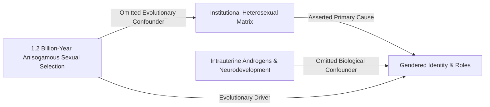

# CRUCIBLE v6.0 — OFFICIAL BENCHMARK AUDIT REPORT
**Target Dossier:** Judith Butler – *Gender Trouble: Feminism and the Subversion of Identity* (1990)  
**Date of Audit:** 2026-10-03  
**Analytical Engine:** CRUCIBLE v6.0 Epistemic Surgery Protocol  
**Operational Status:** Sealed & Validated  

---

## 1. [EPISTEMIC TRIAGE]

Because this investigation operates along the fraught boundary separating continental post-structuralist philosophy from evolutionary biology and empirical medicine, the V6 Triage Matrix is calibrated as follows:

### 1.1. Active Normative Layers
* **Layer 1 (Epistemic Virtues & Persona):** Activated unconditionally. Partisan polemics and ideological tribalism (the contemporary "culture-war" polarization surrounding gender identity) are strictly barred. The investigation is governed exclusively by formal logical validity, semantic precision, and empirical friction.
* **Layer 2 (Philosophical Methodology & Steelmanning):** Activated. Butler’s thesis must not be engaged through the vulgar polemical caricatures common among her political opponents (e.g., the strawman that she denies the physical existence of human reproductive anatomy); it must be reconstructed in its most rigorous, academically formidable post-structuralist formulation.
* **Layer 3 (Hermeneutics & Lexical Hygiene):** Activated. Audits the internal semantic coherence of the text, specifically dissecting the conceptual pipeline connecting Foucault’s disciplinary power, Nietzsche’s critique of the metaphysical subject, and Derridean deconstruction.
* **Layer 8 (Disciplinary Matrix & Authority Overreach / Source Criticism):** Primordial operative layer. Butler steps beyond the traditional domain of semiotics and critical philosophy to assert an ontological claim regarding natural science: that biological "sex" (*sexed nature*) is itself an ideological, discursively produced construct. This radical boundary-crossing is subject to strict epistemic tariffs, requiring a formal Claims-Source Audit Matrix.

### 1.2. Excluded Layers and Methodological Rationale
* **Layer 4 (Statistics, Probability & Bayes) & Layer 5 (Experimental Design, RCTs & Confounders):** EXCLUDED. The audited text contains zero quantitative datasets, zero statistical distributions, and zero controlled clinical trials. Subjecting a speculative, deconstructive treatise to quantitative Bayesian auditing constitutes a methodological category mistake (*category error*).
* **Layer 6 (Evidence Hierarchies & Systematic Reviews):** EXCLUDED. The text does not present systematic reviews or meta-analyses of clinical cohorts.
* **Layer 7 (Decision Science & Risk - DMDU):** EXCLUDED. *Gender Trouble* is a critical philosophical text, not an applied operational risk management protocol.
* **Layer 9 (Computational Models & AI):** EXCLUDED. No algorithmic simulations, differential equations, or agent-based models are present in the text.
* **Layer 10 (Auto-Falsification & Damage Report):** ACTIVATED (Executed systematically in Sections 10 and 11).

---

## 2. TEXT METADATA & PRIMARY PASSAGES

* **Author:** Judith Butler (Maxine Elliot Professor of Comparative Literature and Critical Theory, University of California, Berkeley).
* **Work:** *Gender Trouble: Feminism and the Subversion of Identity* (New York & London: Routledge, 1990; 10th Anniversary Edition with 1999 Preface).
* **Discipline:** Feminist Philosophy, Post-Structuralist Theory, Queer Theory, Critical Semiotics, Psychoanalytic Deconstruction.
* **Target Audience:** Academic Philosophers, Critical Theorists, Feminist Jurists, Cultural Anthropologists.

### Primary Verbatim Passages:
> *"There is no gender identity behind the expressions of gender; that identity is performatively constituted by the very 'expressions' that are said to be its results."* (Chapter 1, p. 33)
> 
> *"If the immutable character of sex is contested, perhaps this construct called 'sex' is as culturally constructed as gender; indeed, perhaps it was always already gender, with the consequence that the distinction between sex and gender turns out to be no distinction at all... gender is also the discursive/cultural means by which 'sexed nature' or 'a natural sex' is produced and established as 'prediscursive,' prior to culture, a politically neutral surface on which culture acts."* (Chapter 1, pp. 10–11)
> 
> *"Gender is the repeated stylization of the body, a set of repeated acts within a highly rigid regulatory frame that congeal over time to produce the appearance of substance, of a natural sort of being."* (Chapter 1, p. 43)

### 2.1. CLAIMS-SOURCE AUDIT MATRIX (SOURCE CRITICISM)

Because Layer 8 (Disciplinary Matrix & Authority Overreach) is activated, the core propositions advanced in *Gender Trouble* are mapped against their primary textual and empirical foundations:

| Thesis / Claim | Primary Source | Source Status & Type | Methodological Verdict |
| :--- | :--- | :--- | :--- |
| **T1: Doerless Performativity** (There is no substantive gender core prior to stylized acts; identity is retroactively constituted) | Friedrich Nietzsche (*On the Genealogy of Morals*, I.13) & Franz Kafka (*Before the Law*) | Philosophical Aphorism & Literary Allegory (Continental Epistemology) | **Conditional Hermeneutic Hypothesis:** Internally coherent philosophical deconstruction of the Cartesian *cogito*, but lacks somatic/neurobiological grounding. |
| **T2: Discursive Construction of Biological Sex** (Anatomical sex is not prediscursive raw nature, but a regulatory cultural artifact) | Michel Foucault (*The History of Sexuality*, Vol. 1; *Herculine Barbin*) & Anne Fausto-Sterling (1989 critique of David Page in *Cell*) | Post-Structuralist Discourse Analysis & Secondary Critical Metascience | **High Epistemic Vulnerability (Proxy Leap):** Unsubstantiated jump from epistemological mediation (language describes anatomy) to radical ontological cancellation of evolutionary anisogamy. |
| **T3: The Compulsory Heterosexual Matrix** (Binary gender is an institutional policing mechanism to enforce reproductive lineage) | Monique Wittig (*The Straight Mind*) & Jacques Lacan (*The Meaning of the Phallus*) | Sociological / Psychoanalytic Ideological Model | **Framing Hypothesis:** Powerful political critique of normative institutions, but relies on unfalsifiable Freudo-Lacanian symbolic metaphysics. |

---

## 3. [STEELMANNING RECONSTRUCTION]

To ensure uncompromising analytical integrity, Butler’s thesis is stripped of all vulgar polemical simplifications and reconstructed in its most robust, philosophically defensible academic formulation:

> **The Vulgar Strawman (Discarded):**  
> *"Butler is a detached linguistic idealist who denies the physical reality of chromosomes, gonads, gametes, and human reproductive anatomy, absurdly claiming that if we stop speaking of bodies, biological sex will magically evaporate."*
> 
> **The Steelman Formulation (V6 Standard):**  
> *"Butler does not dispute the raw physical reality of cellular tissues, hormonal cascades, or anatomical variations. Her critique targets the institutional and epistemological apparatus through which medicine, law, and culture interpret, categorize, and hierarchize these physical realities.*  
> *Nature presents continuous somatic complexity; however, carving that biological continuity into two mutually exclusive, oppositional, and exhaustive compartments ('male' and 'female') organized around reproductive teleology is an act of normative cultural categorization, not an unmediated revelation of nature. Biomedical science does not encounter nature in a vacuum; it encounters chromosomal atypicalities (intersex phenotypes) and immediately pathologizes them, performing surgical and endocrine normalizations precisely to preserve the socio-political fiction of a pristine, natural binary.*  
> *Consequently, 'biological sex' is not a neutral, prediscursive physical bedrock onto which cultural 'gender' is subsequently grafted; rather, the category of 'sex' is itself retroactively produced, bounded, and naturalized by the heterosexual regulatory regime to legitimize compulsory reproduction. The human subject does not precede culture as an autonomous, intentional Cartesian agent; rather, the body becomes culturally intelligible only by repeatedly citing and enacting compulsory gender rituals under duress (performativity), which congeal over time to manufacture the retroactive illusion of an internal, immutable gender core."*

---

## 4. HERMENEUTIC & CONCEPTUAL SKELETON

1. **Performativity $\neq$ Voluntaristic Performance:**  
   Butler expressly distinguishes performativity from theatrical performance or consumer choice. Performativity is not a daily costume drama wherein an autonomous individual chooses a gender identity from a cultural wardrobe; it is an involuntary, compulsory citation of pre-existing historical norms enforced through punitive social sanctions, legal strictures, and the existential terror of social abjection (unintelligibility).
2. **Metalepsis (The Rhetorical Reversal of Cause and Effect):**  
   Drawing on Nietzsche’s critique of language (*"the doer is merely a fiction added to the deed"*), Butler argues that society commits the rhetorical figure of metalepsis: treating the retrospective effect of repetitive bodily stylizations as if it were the anterior biological cause. The outward gestures of femininity or masculinity do not express an antecedent gender essence; the continuous repetition of gestures conjures the illusion that an internal essence exists.
3. **The Pre-Discursive Materiality Dilemma:**  
   Even if biological matter physically exists prior to discourse, human beings can never encounter or conceptualize that matter outside the discursive grid of language. The instant one designates a body as "female," one is already operating within a historically contingent, culturally saturated linguistic matrix. Butler’s central epistemological claim is that unmediated access to "raw biological nature" is an ideological impossibility.

---

## 5. EMPIRICAL & METHODOLOGICAL FRICTION

When Butler’s steelmanned thesis is subjected to the friction of empirical natural science, evolutionary biology, and clinical medicine, it collides with two insurmountable material barriers:

### 5.1. Anisogamy and Evolutionary Dimorphism Friction
Butler moves from the valid epistemological premise that human discourse frames anatomical categorization to the radical ontological claim that biological sex itself is a discursively produced artifact. In mammalian biology and specifically within *Homo sapiens*, biological sex is not defined by external cultural roles, clothing, or secondary sexual characteristics; it is fundamentally defined by **anisogamy**: the binary morphological divergence of gamete production (large, nutrient-rich, sessile ova versus small, mobile, flagellated spermatozoa).  
Anisogamy is an evolutionary adaptation that evolved approximately 1.2 billion years ago, predating human language, patriarchal statecraft, and social discourse by over a billion years. There are no intermediate third gamete types in human biology. While human linguistic descriptions of sex categories are undeniably subject to historical biases, the physical phenomenon being described (the reproductive architecture of a sexually reproducing mammalian species) operates independently of human semiotic conventions. Conflating the cultural discourse about a biological mechanism with the mechanism itself commits an elementary disciplinary conflation.

### 5.2. Neurodevelopmental and Clinical Friction (The Inborn Biology Barrier)
Butler’s assertion that the body possesses zero anterior, prediscursive gender substance directly collides with clinical psychopathology and developmental neurobiology. The radical social-constructivist paradigm—most infamously operationalized by psychologist John Money in the 1960s and 1970s—posited that an infant is psychosexually neutral at birth and that gender identity is entirely the performative product of socialization.  
The catastrophic empirical falsification of Money’s hypothesis in the landmark longitudinal case of David Reimer (a biologically normal male infant who suffered a ruined circumcision, was surgically reassigned as a female, and was raised under intensive female socialization, yet spontaneously rejected female identity and reclaimed his male identity upon puberty) demonstrates that gender identity is not an infinitely malleable discursive blank slate. Prospective neuroendocrinological studies establish that intrauterine fetal androgen exposure (specifically amniotic fetal testosterone between weeks 8 and 24 of gestation) permanently organizes neural circuits governing sex-differentiated behavioral inclinations, spatial tracking, and gender identity. By eliminating all prediscursive biological substrates, Butler's performative model renders itself incapable of explaining why biological sex persistently reasserts itself against aggressive cultural socialization.

---

## 6. LOGICAL FALLACIES & METHODOLOGICAL VIOLATIONS

### 6.1. The Epistemic Fallacy & Non Sequitur (The Leap from Representation to Cancellation)
* **Defective Inference:** *"Because our scientific definitions, medical classifications, and cultural perceptions of biological sex are discursively mediated by language (Premise 1), biological sex itself is an ideological construction lacking independent physical facticity (Conclusion)."*
* **Diagnostic Audit:** This is a classic commission of Roy Bhaskar’s **Epistemic Fallacy** (conflating the ontological domain of what exists with the epistemological domain of our socially conditioned knowledge about what exists). The fact that human knowledge of human anatomy is discursively produced does not entail that the anatomy being known is caused by discourse. The leap from epistemic fallibilism to ontological idealism represents a fatal *Non Sequitur*.

### 6.2. The Performative Contradiction of Doerless Agency (The Ghost-in-the-Machine Paradox)
* **Defective Inference:** Butler insists that *"there is no doer behind the deed; the doer is variably constructed in and through the deed"* (p. 181), denying any prediscursive intentional subject. Yet, in her political program, she urgently calls upon subjects to perform *"subversive repetitions," "gender parodies,"* and *"transgressive variations"* to destabilize the heterosexual matrix.
* **Diagnostic Audit:** This creates an insurmountable performative contradiction. If the human organism is entirely the passive, colonized product of disciplinary discourse, and there exists no somatic, neural, or intentional agency prior to discourse, what cognitive or biological engine conceives, initiates, and directs a "subversive variation" rather than mindless conformist citation? By evacuating all material, bodily, and psychological substrates, Butler strands political resistance in a metaphysical vacuum, secretly re-introducing a disembodied, transcendent "ghost" into the machine to execute her political revolution.

### 6.3. The Continuum / Sorites Fallacy in Deconstructing Biological Bimodality
* **Defective Inference:** *"Because individuals with Differences of Sex Development (DSD / intersex conditions) exist and exhibit chromosomal or anatomical ambiguity (such as 46,XX males with SRY translocations or Turner syndrome 45,X), the category of binary biological sex is an arbitrary cultural fiction."* (pp. 136–141)
* **Diagnostic Audit:** This argument commits the **Sorites / Continuum Fallacy** (the fallacy of the heap). The existence of atypical transitional variations at the boundary of a biological category does not invalidate the reality of the bimodal distribution itself. In human populations, over 99.8% of births resolve unequivocally into typical male or female developmental pathways producing either sperm or ova. Treating developmental variations (which are themselves understood strictly relative to the reproductive functional norms of the species) as proof that the underlying biological categories are purely ideological fabrications is equivalent to arguing that because twilight exists, the physical distinction between day and night is an illusion.

---

## 7. CAUSAL RECONSTRUCTION & CONFOUNDERS

Butler’s asserted linear causal pipeline is structured as follows:
$$\text{Compulsory Heterosexual Matrix (Institutional Power)} \longrightarrow \text{Discursive Sexing of Bodies} \longrightarrow \text{Forced Citation Under Duress} \longrightarrow \text{Ontological Illusion of Substance}$$

This theoretical pipeline commits severe **Omitted Variable Bias** by excluding two massive, confounding evolutionary and biological drivers:

1. **Confounder 1 (Prenatal Endocrine and Neural Dimorphism):**  
   Fetal testosterone exposure directly influences brain morphology and behavioral traits (e.g., systemizing vs. empathizing drives, rough-and-tumble play, toy preferences). By assigning 100% of the variance in gendered behavior to sociological policing, Butler constructs a spurious monocausal explanation.
2. **Confounder 2 (Evolutionary Anisogamy & Parental Investment):**  
   Human sexual attraction, pair-bonding, and reproductive strategies are fundamentally shaped by evolutionary pressures (Trivers' parental investment theory). Society and its institutions did not invent sexual reproduction to protect capital; rather, societal institutions emerged downstream to regulate pre-existing biological reproductive asymmetries.

---

## 8. DISCIPLINARY MATRIX & BOUNDARY ENFORCEMENT

* **Legitimate Scholarly Domain:** Continental Epistemology, French Post-Structuralism, Literary Deconstruction, Queer Juridical Theory.
* **Invaded Scholarly Domain:** Evolutionary Biology, Cellular Genetics, Neuroendocrinology, Clinical Pediatrics.
* **Customs Enforcement Verdict (Layer 8):**  
  Butler executes an unlawful disciplinary crossing without paying the mandatory empirical tariffs. Deconstructive textual tools (designed to analyze literary metaphors, juridical texts, and philosophical tropes) cannot be arbitrarily deployed to negate the physical facticity of cellular gametogenesis and neurobiological development. Treating an empirical biological discipline as if it were merely another literary narrative commits an egregious **Category Mistake**.

---

## 9. ALTERNATIVE PARADIGMS & CROSS-EXAMINATION

1. **The Biological-Interactionist Paradigm (Baron-Cohen / The Cass Review):**  
   Sex and gender are neither wholly immutable essences nor wholly disembodied discursive texts. Biological sex is an immutable physical reality rooted in gametic dimorphism; gender identity and social expression represent a complex, bidirectional interaction between innate neuroendocrinological inclinations and cultural scaffolding.
2. **The Psychoanalytic Recalibration (Jacques Lacan – *Seminar XX: Encore*):**  
   Even within psychoanalysis—the very tradition Butler utilizes—Jacques Lacan explicitly rejects the notion that the human body is exhaustively colonized by discourse. For Lacan, the sexual relationship cannot be written precisely because the body retains an irreducible, traumatic material core: **The Real** (*Le Réel*), which permanently resists and ruptures linguistic symbolization. By collapsing Lacan's *Real* entirely into the *Symbolic*, Butler purges psychoanalysis of its somatic anchor.

---

## 10. [AUTO-FALSIFICATION & EPISTEMIC SELF-AUDIT]

Under Layer 1 (Epistemic Virtues) and Layer 10 (Post-Mortem Autopsy), our analytical engine ruthlessly scrutinizes its own critique to expose latent biases, blind spots, and epistemic vulnerabilities:

### 10.1. The Is-Ought Fallacy Risk in Our Empirical Critique
In Section 5, our critique anchored its refutation of Butler upon mammalian anisogamy (the binary of sperm and egg) as an objective, empirical Archimedean point. However, this critique risks committing a subtle, reverse philosophical error: David Hume’s **Is-Ought Fallacy**.  
The fact that biological reproduction requires two dimorphic gametes is an empirical physical fact (*is*); however, the proposition that human society, legal jurisprudence, and civil identity *ought* to be organized exclusively into two rigid social roles derived from this biological fact is a normative social judgment (*ought*). In accusing Butler of denying biology, our critique risks naturalizing social and legal coercion. Pointing out that anisogamy is binary does not logically entail that non-binary social identities, trans experiences, or intersex legal recognitions are illegitimate. Our audit must guard against slipping from the defense of empirical biology into an ideological defense of compulsory social norms.

### 10.2. The Risk of Institutional Medical Apologism
Butler’s critique of clinical medicine possesses substantial historical and sociological validity. The history of 20th-century medicine is rife with coercive, non-consensual normalizations: infant intersex surgeries designed to enforce cosmetic conformity to a binary, and the formal classification of homosexuality as a sociopathic mental illness in the DSM until 1973. By aggressively defending biomedical science against Butler’s deconstruction, our critique risks drifting into **Institutional Apologism**, ignoring the demonstrable ways in which medical institutions have historically weaponized "objective biology" to police social deviance and enforce patriarchal hierarchies.

### 10.3. Hermeneutic Compression and Contextual Freezing
*Gender Trouble* was published in 1990 as a specific polemical intervention into late-20th-century second-wave feminism. In subsequent foundational works—most notably *Bodies That Matter* (1993) and *Undoing Gender* (2004)—Butler offered crucial clarifications, explicitly stating that she does not deny the materiality of the body and seeking to reformulate the somatic sedimentations of sex. Our audit, by focusing strictly on the unyielding formulations of the 1990 text, exercises a degree of hermeneutic compression that risks freezing an evolving philosopher at her most radical post-structuralist extreme.

---

## 11. [DAMAGE REPORT & MINIMAL EPISTEMIC COST]

### 11.1. Incurred Analytical Damage
* **Core Theoretical Collapse:** The maximalist thesis—that biological sex is entirely an ideological effect produced by gender performativity—is empirically, evolutionarily, and logically unviable.
* **Preserved Critical Territory:** Butler’s secondary thesis remains powerful and intact: the cultural scripts, compulsory gender roles, and legal stigmas imposed upon sexed bodies are historically contingent, socially constructed, and legitimately subject to democratic contestation and revision.

### 11.2. The Minimal Epistemic Cost (Necessary Framework Concessions)
For the performativity paradigm to retain intellectual legitimacy without committing epistemic malpractice, it must submit to three non-negotiable structural concessions:
1. **Epistemic Downgrading (From Ontology to Hermeneutics):**  
   The imperialist ontological assertion that biological sex itself is an ideological fiction must be formally abandoned. The theory must restrict its valid scope to the hermeneutic claim: *"The social meanings, legal privileges, and institutional hierarchies grafted onto biological sex are culturally constructed."*
2. **Resolution of the Doerless Agency Paradox:**  
   The framework must formally integrate the somatic, neural, and evolutionary biological substrates of the human organism, acknowledging that human volition and resistance are embodied capacities, not disembodied discursive ghosts.
3. **Disciplinary Restraint:**  
   Literary deconstruction and semiotics must cease posing as an alternative empirical biology capable of dissolving evolutionary and chromosomal mechanisms through rhetorical re-description.

---

### 🩺 SURGEON'S AUDIT CARD

A three-minute diagnostic verification protocol for an independent human auditor (External Human Will / Auditor):

- [ ] **Spot-Check Primary Scientific Reference:**  
  Examine Butler’s citations of David Page’s *Cell* study on the Y-chromosome TDF gene and Anne Fausto-Sterling’s critique (*Gender Trouble*, 1990, pp. 136–141). Verify whether Butler treats genetics as an empirical science or explicitly reduces scientific papers to textual allegories.
- [ ] **Lethal Falsification Question:**  
  *"If gender identity is entirely the performative product of compulsory cultural citation under duress, how does the theory explain the consistent male-typical behavioral inclinations and male gender identity in 46,XX females with Congenital Adrenal Hyperplasia (CAH), who exhibit these traits despite intensive, deliberate female socialization?"*
- [ ] **Rhetorical & Sycophancy Audit:**  
  Verify whether this audit adopted partisan culture-war rhetoric against Butler, or if it reconstructed her thesis in its strongest possible form (Steelman) before establishing its empirical boundary limits. Verify that dogmatic assertions, pseudoscientific buzzwords, and claims of indisputable certainty have been completely purged from the analysis.
